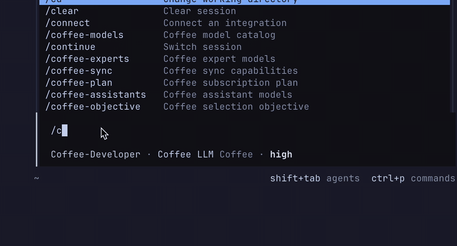
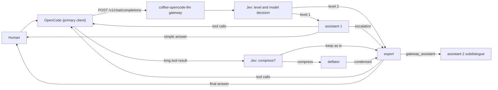
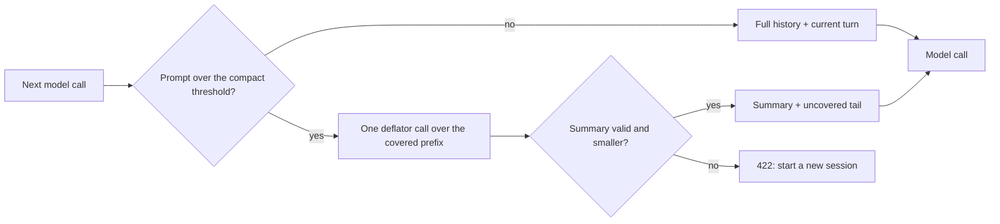

# Coffee LLM

[English](README.md) · [Русский](README.ru.md) · [简体中文](README.zh-cn.md)

A personal gateway in front of many models. In OpenCode, Cursor and Codex the model is named
`Coffee LLM`; in code and configuration the name is `coffee-opencode-llm`.

The gateway is built for **OpenCode first**: it speaks the OpenCode provider protocol, streams the
Thought reasoning part and progress events, and keeps its session headers. Cursor and Codex
connect through the same OpenAI-compatible API.

You talk to one address. The gateway decides who leads the turn: a cheaper assistant gathers
data, the expert judges and answers, and the expensive model only sees what it actually needs.

In OpenCode, `/coffee-assistants` and `/coffee-experts` open the corresponding model selectors:



| OpenCode command | Description |
| --- | --- |
| `/coffee-assistants` | Open the selector for models in the `coffee-assistant` group. |
| `/coffee-experts` | Open the selector for models in the `coffee-expert` group. |

## Status

The gateway is written in Go; all current work happens on the `go` branch. The earlier Python
prototype was a separate project and is not part of this repository.

## How it works



Two access levels, raised only upwards:

- **Level 1** — assistant 1 owns the dialogue and gets the full client tool catalog.
- **Level 2** — the expert owns the dialogue with the full client tool catalog plus the virtual
  `gateway_assistant` tool. Assistant 2 runs its own subdialogue, uses the client tools and
  returns findings, sources, limits and gaps.
- The **deflator** is the youngest role: a separate cheap model that condenses long tool results
  and the covered history. It never talks to the human and never takes quota from the senior
  roles.

The gateway never executes external calls itself: it returns them to the client, the client
executes them and sends results back. That keeps secrets and MCP connections on the client side.

## Context compaction

The stored history is append-only and never rewritten. Compaction changes what is sent to the
model, not the archive:



- Compaction triggers when the estimated prompt exceeds `history_compact_pct` of the selected
  model's usable input window (the window minus the output reserve).
- One deflator request summarizes the covered prefix once; the current human turn, its tool calls
  and results stay intact.
- A valid summary is stored with its covered boundary and reused on later turns; the covered
  prefix is not resent.
- Any failure — an empty, incomplete or non-shrinking summary, or a result that does not fit the
  budget — stops the request with `422`, and that session id stays blocked until a new OpenCode
  session.

## Reasoning

Model reasoning streams into the OpenCode Thought part natively, as `reasoning_content`, never
mixed into the answer. Two gates decide where it exists at all, with identical effect on the
screen, the archive and the model context: `reasoning_context_enabled` is the master switch for
every actor, and `assistant2_reasoning_enabled` narrows the helper alone. The deflator never has
reasoning.

## Models

Models are data, not code. `config/models.yaml` lists experts and assistants with a short
description each; a small decision model picks among the models that pass hard filters
(context window, quota left, tool support, modality). The expert is pinned until the final answer
to the human; a new human message opens a new choice.

One upstream: OpenCode inference, one key. Other providers are connected in the OpenCode console
and are indistinguishable to the gateway.

## Runtime settings

Settings are global, stored in the database and applied without a restart:

| Setting | Values | Default | Meaning |
| --- | --- | --- | --- |
| `objective_mode` | `balanced` `quality` `price` | `balanced` | reserved: stored and shown, no effect on routing yet |
| `reasoning_mode` | `min` `medium` `high` `max` `client` | `client` | reasoning effort; `client` follows the effort of each model call |
| `reasoning_context_enabled` | `off` `on` | `off` | master switch: reasoning everywhere, or nowhere |
| `assistant2_reasoning_enabled` | `off` `on` | `on` | helper reasoning, same effect on screen and context |
| `subscription_mode` | `free` `go` `go-plus` `go-teams` | `free` | upstream plan and base URL |

```sh
coffee-opencode-llm settings set reasoning_context_enabled on
```

## Limits

Every ceiling is a configuration parameter with a unit in its name — bytes, characters,
milliseconds, tokens, steps. There are no magic numbers in the code: a missing key fails the
startup instead of silently falling back to a default.

## Run

```sh
go run ./cmd/coffee-opencode-llm serve -config config/gateway.yaml -models config/models.yaml
```

Required environment: `OPENCODE_INFERENCE_URL`, `OPENCODE_API_KEY`, `JEV_BASE_URL`, `JEV_API_KEY`.
Secrets are never stored in configuration files. `make run` does not read `.env`: export the
variables in your shell or service manager.

## Commands

Run commands through the built binary or prefix them with
`go run ./cmd/coffee-opencode-llm`.

| Command | Description |
| --- | --- |
| `serve` | Start the HTTP gateway. |
| `migrate` | Apply pending database migrations. |
| `catalog show` | List models, roles, availability and quota; use `-json` for machine-readable output. |
| `catalog group add/remove <group> <model-id>` | Add or remove a model from `coffee-assistant` or `coffee-expert`. |
| `catalog enable/disable <model-id>` | Override whether a catalog model is available. |
| `catalog exclude/include <model-id>` | Manually exclude a model from or return it to rotation. |
| `settings show/set <key> [value]` | Inspect or change global runtime settings; changes apply without restart. |
| `plan show/set <value>` | Inspect or change the plan: `free`, `go`, `go-plus` or `go-teams`. |
| `retention` | Dry-run the configured retention cleanup; deletes nothing. |

To apply retention cleanup, use `make retention-apply RETENTION_CONFIRM=yes`. This permanently
deletes expired history in batches. Run the dry-run first and back up the database.

The gateway listens on `127.0.0.1:8080` by default and publishes one model:

```sh
curl http://127.0.0.1:8080/v1/models
```

## Clients

| Client | Setting |
| --- | --- |
| OpenCode (primary) | provider with `baseURL` pointing at the gateway, model `coffee-opencode-llm` |
| Cursor | OpenAI-compatible base URL, model `coffee-opencode-llm` |
| Codex | `wire_api = "responses"`, base URL of the gateway |

## Repository layout

```
cmd/coffee-opencode-llm/       entry point
internal/             config, httpapi, engine, router, catalog, ledger, jev, transport, store
api/openapi.yaml      contract for clients and the plugin
config/               gateway.yaml (limits), models.yaml (catalog)
migrations/           NNNN_name.sqlite.sql, NNNN_name.postgres.sql
```

## Documentation

Specifications and decision records are kept locally in `docs/` and are not part of the repository.
The single public contract is `api/openapi.yaml`; backward compatibility is guaranteed within `/v1`,
breaking changes go to `/v2`.

## License

See [LICENSE](LICENSE).
