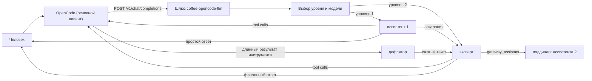
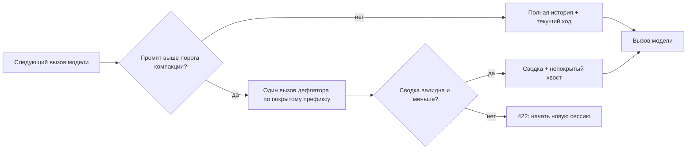

# Coffee LLM

[English](README.md) · [Русский](README.ru.md) · [简体中文](README.zh-cn.md)

Личный шлюз перед множеством моделей. В OpenCode, Cursor и Codex модель называется `Coffee LLM`;
в коде и конфигурации — `coffee-opencode-llm`.

Шлюз построен **в первую очередь под OpenCode**: говорит на языке его провайдера, стримит
Thought-часть reasoning и progress-события, сохраняет заголовки его сессии. Cursor и Codex
подключаются через тот же OpenAI-совместимый API.

Вы говорите с одним адресом. Шлюз сам решает, кто ведёт ход: дешёвый ассистент собирает данные,
эксперт судит и отвечает, дорогая модель видит только то, что ей действительно нужно.

## Статус

Шлюз переписывается с Python на Go. Работа идёт в ветке `go`; `main` не трогается. Python-реализация
хранится в `coffee_llm/` только как референс и будет удалена после первого рабочего Go-релиза.

## Как это работает



Два уровня доступа, только повышение:

- **Уровень 1** — ассистент 1 владеет диалогом и получает полный каталог инструментов клиента.
- **Уровень 2** — эксперту принадлежит диалог: полный каталог клиента плюс виртуальный инструмент
  `gateway_assistant`. Ассистент 2 ведёт собственный поддиалог, пользуется инструментами клиента
  и возвращает находки, источники, лимиты и пробелы.
- **Дефлятор** — младшая роль: отдельная дешёвая модель, сжимающая длинные результаты
  инструментов и покрытую историю. Человеку не отвечает, квоту у старших ролей не отбирает.

Шлюз никогда не исполняет внешние вызовы сам: он отдаёт их клиенту, клиент исполняет и присылает
результаты. Секреты и MCP-подключения остаются на стороне клиента.

## Компакция контекста

Сохранённая история append-only и никогда не переписывается. Компакция меняет то, что уходит
модели, а не архив:



- Компакция запускается, когда оценка промпта превышает `history_compact_pct` доступного входного
  окна выбранной модели (окно минус резерв под ответ).
- Один запрос дефлятора суммирует покрытый префикс однократно; текущий ход человека, его вызовы и
  результаты инструментов остаются нетронутыми.
- Валидная сводка сохраняется вместе с границей покрытия и переиспользуется в следующих ходах;
  покрытый префикс повторно не отправляется.
- Любой отказ — пустая, неполная или несокращающая сводка, результат вне бюджета — останавливает
  запрос с `422`; этот session id блокируется до новой OpenCode-сессии.

## Reasoning

Reasoning модели стримится в Thought-часть OpenCode нативно, полем `reasoning_content`, не
примешиваясь к ответу. Два gate решают, где оно вообще существует, с одинаковым действием на
экран, архив и контекст модели: `reasoning_context_enabled` — мастер-выключатель для всех
актёров, `assistant2_reasoning_enabled` сужает только помощника. У дефлятора reasoning нет
никогда.

## Модели

Модели — это данные, а не код. `config/models.yaml` описывает экспертов и ассистентов с короткой
характеристикой; маленькая решающая модель выбирает среди тех, кто проходит жёсткие фильтры
(окно контекста, остаток квоты, поддержка инструментов, модальность). Эксперт закрепляется до
финального ответа человеку; новая реплика человека открывает выбор заново.

Один апстрим: OpenCode inference, один ключ. Остальные провайдеры подключаются в консоли OpenCode
и для шлюза неразличимы.

## Runtime-настройки

Настройки глобальные, хранятся в БД и применяются без рестарта:

| Настройка | Значения | По умолчанию | Смысл |
| --- | --- | --- | --- |
| `objective_mode` | `balanced` `quality` `price` | `balanced` | что оптимизирует решающая модель |
| `reasoning_mode` | `min` `medium` `high` `max` `client` | `client` | уровень reasoning |
| `reasoning_context_enabled` | `off` `on` | `off` | мастер-выключатель: reasoning везде или нигде |
| `assistant2_reasoning_enabled` | `off` `on` | `on` | reasoning помощника, экран и контекст одинаково |
| `subscription_mode` | `free` `go` `go-plus` `go-teams` | `free` | план апстрима и base URL |

```sh
coffee-opencode-llm settings set reasoning_context_enabled on
```

## Лимиты

Каждый потолок — ключ конфигурации с единицей в имени: байты, символы, миллисекунды, токены, шаги.
Магических чисел в коде нет: отсутствующий ключ роняет старт вместо тихого дефолта.

## Запуск

```sh
go run ./cmd/coffee-opencode-llm serve -config config/gateway.yaml -models config/models.yaml
```

Обязательное окружение: `OPENCODE_INFERENCE_URL`, `OPENCODE_API_KEY`, `JEV_BASE_URL`, `JEV_API_KEY`.
Секреты в файлах конфигурации не хранятся. `make run` не читает `.env`: экспортируйте переменные
в шелле или сервис-менеджере.

Шлюз слушает `127.0.0.1:8080` по умолчанию и публикует одну модель:

```sh
curl http://127.0.0.1:8080/v1/models
```

## Клиенты

| Клиент | Настройка |
| --- | --- |
| OpenCode (основной) | провайдер с `baseURL` на шлюз, модель `coffee-opencode-llm` |
| Cursor | OpenAI-совместимый base URL, модель `coffee-opencode-llm` |
| Codex | `wire_api = "responses"`, base URL шлюза |

## Структура репозитория

```
cmd/coffee-opencode-llm/       точка входа
internal/             config, httpapi, engine, router, catalog, ledger, jev, transport, store
api/openapi.yaml      контракт для клиентов и плагина
config/               gateway.yaml (лимиты), models.yaml (каталог)
migrations/           NNNN_name.sqlite.sql, NNNN_name.postgres.sql
coffee_llm/           Python-референс, удаляется после первого Go-релиза
```

## Документация

Спецификации и ADR хранятся локально в `docs/` и не входят в репозиторий.
Единый публичный контракт — `api/openapi.yaml`; обратная совместимость гарантируется внутри `/v1`,
ломающие изменения уходят в `/v2`.

## Лицензия

См. [LICENSE](LICENSE).
