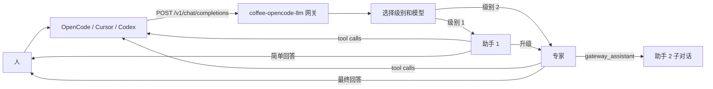
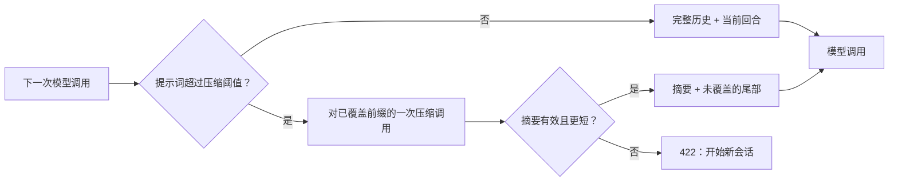

# Coffee LLM

[English](README.md) · [Русский](README.ru.md) · [简体中文](README.zh-cn.md)

放在许多模型前面的个人网关。在 OpenCode、Cursor 和 Codex 中模型名叫 `Coffee LLM`；在代码和配置里是不带空格的 `coffee-opencode-llm`。

你只对一个地址说话。由网关决定这一步谁来主导：便宜的助手收集数据，专家判断并作答，昂贵的模型只看到真正需要的内容。

## 状态

网关正在从 Python 重写为 Go。工作在 `go` 分支进行；`main` 保持不动。Python 实现仅作为参考保留在 `coffee_llm/`，将在第一个可用的 Go 版本发布后移除。

## 工作方式



两个访问级别，只升不降：

- **级别 1** — 助手 1 主导对话，获得客户端的完整工具目录。
- **级别 2** — 专家主导对话：客户端的完整目录，加上虚拟工具 `gateway_assistant`。助手 2
  运行自己的子对话，使用客户端工具，交回发现、来源、限额和缺口。

网关从不自己执行外部调用：它把调用交回客户端，由客户端执行并送回结果。密钥和 MCP
连接因此留在客户端一侧。

## 上下文压缩

保存的历史只追加，从不重写。压缩改变的是发给模型的内容，不是档案：



- 当提示词的估算超过 `history_compact_pct`（所选模型可用输入窗口的百分比，窗口扣除输出
  预留）时触发压缩。
- 一个压缩请求一次性概括已覆盖的前缀；当前回合、它的工具调用和结果保持原样。
- 有效的摘要连同覆盖边界一起保存，在后续回合复用；已覆盖的前缀不再重复发送。
- 任何失败——摘要为空、不完整、没有变小或超出预算——都会以 `422` 终止请求；该会话
  id 将被封锁，直到开启新的 OpenCode 会话。

## 思考过程（reasoning）

模型的 reasoning 以 `reasoning_content` 字段原生流入 OpenCode 的 Thought 部分，从不混入
回答正文。`reasoning_trace_scope` 决定哪些调用拥有它：`full` — 所有角色；`final` — 只有
回答或工具调用会到达你的那些调用。压缩器永远没有 reasoning。开启
`reasoning_context_enabled` 后，已完成调用的 reasoning 存档副本会在后续提示词中复用——
前提是客户端历史确认它未被修改。

## 模型

模型是数据，不是代码。`config/models.yaml` 列出专家和助手及各自的简短说明；一个轻量
决策模型在通过硬过滤（上下文窗口、剩余配额、工具支持、模态）的模型中挑选。专家固定
到给出最终回答为止；新的人类消息会重新开启选择。

只有一个上游：OpenCode inference，一个密钥。其他提供商在 OpenCode 控制台接入，对网关
不可区分。

## 运行时设置

设置是全局的，保存在数据库中，无需重启即生效：

| 设置 | 取值 | 含义 |
| --- | --- | --- |
| `objective_mode` | `balanced` `quality` `price` | 决策模型优化什么 |
| `reasoning_mode` | `min` `medium` `high` `max` `client` | reasoning 力度 |
| `reasoning_context_enabled` | `off` `on` | 在后续提示词中复用 reasoning 存档 |
| `reasoning_trace_scope` | `full` `final` | 哪些调用拥有 reasoning，处处一致 |
| `subscription_mode` | `free` `go` `go-plus` `go-teams` | 上游套餐和 base URL |

```sh
coffee-opencode-llm settings set reasoning_trace_scope final
```

## 限制

每个上限都是带单位的配置键——字节、字符、毫秒、token、步数。代码里没有魔法数字：
缺失的键会让启动失败，而不是悄悄回退到默认值。

## 运行

```sh
go run ./cmd/coffee-opencode-llm serve -config config/gateway.yaml -models config/models.yaml
```

必需的环境变量：`OPENCODE_INFERENCE_URL`、`OPENCODE_API_KEY`、`JEV_BASE_URL`、`JEV_API_KEY`。
密钥永远不写进配置文件。

网关默认监听 `127.0.0.1:8080`，对外只发布一个模型：

```sh
curl http://127.0.0.1:8080/v1/models
```

## 客户端

| 客户端 | 配置 |
| --- | --- |
| OpenCode | provider 的 `baseURL` 指向网关，模型 `coffee-opencode-llm` |
| Cursor | OpenAI 兼容 base URL，模型 `coffee-opencode-llm` |
| Codex | `wire_api = "responses"`，网关的 base URL |

## 仓库结构

```
cmd/coffee-opencode-llm/       入口
internal/             config, httpapi, engine, router, catalog, ledger, jev, transport, store
api/openapi.yaml      面向客户端和插件的契约
config/               gateway.yaml（限制），models.yaml（目录）
migrations/           NNNN_name.sqlite.sql, NNNN_name.postgres.sql
coffee_llm/           Python 参考，第一个 Go 版本发布后移除
```

## 文档

规格说明和决策记录保存在本地 `docs/`，不属于本仓库。唯一的公开契约是
`api/openapi.yaml`；`/v1` 内保证向后兼容，破坏性变更进入 `/v2`。

## 许可证

见 [LICENSE](LICENSE)。
